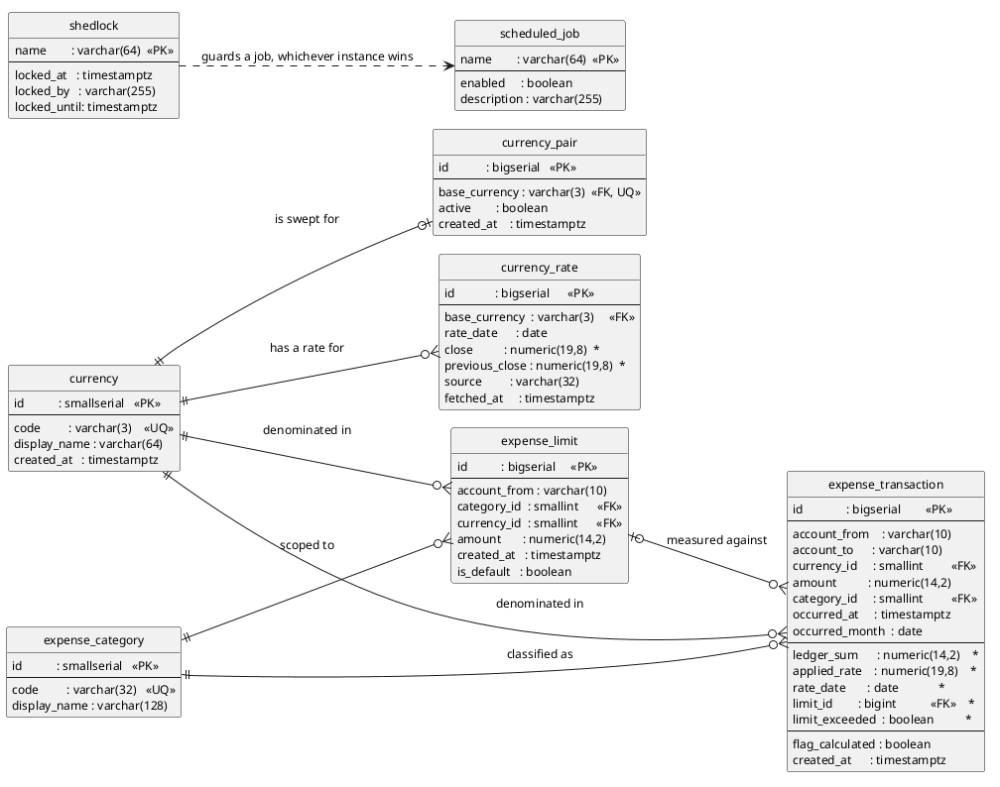

# Financial Transactions

Microservice for monthly USD spend limits: it accepts expense transactions in real time,
converts them to USD, and flags the ones that exceed the client's monthly limit.

Spring Boot 4.0.8, Java 25, PostgreSQL, Flyway.

## How the flag is decided

```
limit_exceeded = (sum of the month's transactions up to and including this one) > (the limit in effect)
```

The limit in effect is the latest one installed no later than the transaction's date. Two
consequences are worth stating outright, because both are easy to get wrong and both are
covered by tests:

- **A remaining balance of exactly zero is not exceeded.** The comparison is strict.
- **A new limit does not reset the month.** On 10.01 with 1100 USD already spent and a fresh
  limit of 2000 USD, the remaining balance is 900.

## Month timezone

**UTC**, configured as `app.month-timezone` in `application.yml`.

Transactions arrive with assorted offsets, so month boundaries have to be computed in one
explicit timezone. `domain/MonthBoundary` is the only place that conversion happens, and it is
the only thing in the codebase allowed to decide which month a transaction belongs to.

The month is also stored on the row as `occurred_month`, so reporting does not have to
recompute the boundary for every query.

## Currencies

The currency code is a **verified reference, not a string**.
`expense_transaction.currency_id` and `expense_limit.currency_id` are foreign keys to a
`currency` lookup table, and `currency_rate.base_currency` references `currency(code)`.

The schema refuses a lowercase code outright, so `kzt` cannot end up as a second currency
next to `KZT` — that is the entire point of the table.

**What the migration seeds is three codes**: `USD`, because it is the ledger currency and
every limit amount refers to it, and `KZT` and `RUB`, which the specification names. The rest of
ISO 4217 used to be 157 rows inside `V1__init.sql` — data in a file whose job is to describe a
schema, duplicating something the code already knew how to do, going stale while an applied Flyway
file cannot be rewritten. It is gone. `CurrencyBootstrap` reads the provider's currency list when
the service comes up, and `WeeklyCurrencyImport` refreshes it weekly: new codes are rare and the
endpoint is paid, so a weekly sweep rather than a daily one. Both call the same
`CurrencyImporter`.

The bootstrap **does not hold the startup**. It hands its work to a virtual thread once the context
is ready, because the alternative is a service that starts only when the rate provider answers, and
this project is built so that a provider outage is not an outage here. The cost is that a
transaction in a currency published minutes ago is refused with 404 for a few seconds — which is
what it gets on any deployment with no provider configured at all, where the lookup stays at three
codes. Both write with `insert … on conflict do nothing`, so the import is idempotent and several
replicas starting at once do not race each other into a constraint violation.

Two further things pull in different directions and are kept separate:

- **Rates are pre-fetched for a tracked subset** — by default `KZT` and `RUB`, which are the
  bases of the `KZT/USD` and `RUB/USD` pairs the specification asks to be fetched daily (п.3).
  The list lives in the `currency_pair` table, not in `application.yml`: every poll costs money,
  so what is kept warm is an operator's decision made with a database session, not a property
  that needs a release. Adding one is `insert into currency_pair (base_currency) values ('EUR')`,
  retiring one is `update currency_pair set active = false`, and stored rates stay where they are.
- **The table has no quote column, deliberately.** The quote is `app.ledger.currency-code` —
  a single value — and `currency_rate` stores rates without a quote because it is implied. A
  stored copy here would be a second source of truth that can disagree with the configuration,
  and reconciling it would take a code-level check on every sweep. Because the quote is supplied
  at request time, moving the ledger to another currency requires **no change to this table**.
- **Any currency in the lookup is accepted** in a transaction, independently of that list. The
  subset decides what is kept warm, not what is allowed. The specification asks for "тенге,
  рублях и других валютах", so a transaction currency is never validated against the pairs
  list.

Conversion is `ledger_sum = sum × close`, with `close` meaning units of the ledger currency per
one unit of the transaction currency. The multiplication happens first and the result is rounded
once to two decimals: rounding the rate before multiplying would throw away the only precision the
conversion has.

Both the currency and the scale are configuration, not constants:

```yaml
app:
  ledger:
    currency-code: USD   # limits are denominated in it, rates are quoted against it
    amount-scale: 2      # decimal places an amount is stored and reported with
```

The specification fixes USD, and nothing in the code assumes it stays that way. Moving the ledger
to EUR is a property change and nothing else: the quote is never stored, so the daily sweep starts
asking for `KZT/EUR` on its own.

### Failure strategy for the external API

The specification asks for rates to be stored locally and for ingestion never to lose data.
The lookup order in `ExchangeRateService` is:

1. **Redis**, holding what a previous lookup already resolved. Optional in every direction: a miss,
   an unreadable value or an unreachable Redis all fall through to the step below.
2. **Local database, exact day.** `close` is used; when the day has no close of its own
   (weekend, holiday) `previous_close` is used instead, which is what the specification asks
   for.
3. **Local database, most recent rate not later than that day.** This step is not in the
   specification but is needed in practice: a Monday close may not be published yet when the
   transaction arrives on Tuesday, and without this such a transaction would be stuck.
4. **One external call** for the pair, with the configured timeouts and retry count. The retry
   is resilience4j's `Retry` core API configured from `app.rates.attempts` and
   `app.rates.retry-backoff`, not its `@Retry` aspect: the aspect needs the Spring starter and AOP,
   and the policy is built once in the constructor anyway.

If all three fail, the transaction is **stored with no flag**: `ledger_sum`, `limit_exceeded`
and `limit_id` stay null and `flag_calculated` is false. Nothing is lost, and the row is
picked up by a later recalculation. Writing `limit_exceeded = false` there would be a lie in
the reporting output, which is why the column is nullable and paired with the flag.

An external outage surfaces as `ExternalServiceUnavailableException` and a 503. The exception is
named after the failure rather than after rates specifically, so the next integration reuses it.

The daily refresh covers only the configured pairs. Other currencies are fetched on demand,
because each external call costs money and sweeping currencies nobody transacts in would waste
that budget.


### The Redis rate cache

Optional requirement 2\* — the rates are cached in Redis in front of `currency_rate`. Worth being
precise about what it is: the table is indexed, answers the same question, and never fails, so the
cache saves one round trip per transaction and nothing more. It is not a source of truth and is
never allowed to become one.

**Every failure falls through.** Redis unreachable, a value that will not decode, the cache
disabled entirely — each one costs a database query and produces the same converted amount. The
transaction is stored either way. `RateCacheDisabledTests` runs a context with
`app.cache.enabled=false` and asserts the conversion still happens, because "turn it off" has to be
a supported deployment rather than a line in a property file.

**A miss is never cached.** Caching "there is no rate for this day" would keep sending transactions
down the paid external path after the daily sweep published one — the exact failure the cache exists
to prevent.

**Invalidation uses a generation counter, not key deletion.** A cached answer is keyed by the day
that was *asked for*, while the rate that answered it may be older: step 3 above deliberately answers
a question about the 5th with the rate of the 1st. Storing a new rate therefore has to retire the
entry cached under the 5th, and under every later day too. Each pair has a counter in its key, and a
write increments it, so one `INCR` retires all of it with no `SCAN` and no set of keys to track. The
cost is one extra `GET` per lookup. `app.cache.ttl` is the backstop for a lost invalidation, not the
mechanism.

`app.cache.key-prefix` namespaces the keys, since a shared Redis should not receive this service's
keys at its root. `financial.rates.resolved` counts a `source="cache"` resolution, which is the
number that says whether the cache is earning its place.

## The schema



The source of the diagram is `docs/db-model.puml`, rendered with PlantUML; the tables are the
migrations, and a column added to a diagram but not to a migration is a drawing rather than a schema.
Four things it is worth seeing at a glance:

- **`currency` is a verified reference, everywhere.** Both `expense_limit.currency_id` and
  `expense_transaction.currency_id` point at it, and `currency_rate.base_currency` references its code.
  Nothing in the schema stores a currency code from a request as a string.
- **There is no `account` table**, and `account_from` / `account_to` are plain `varchar(10)` columns
  with a digit check. The specification describes a field format, not an entity.
- **`expense_transaction.limit_id` is a foreign key, so the flag stays reproducible.** Recomputing
  which limit was in effect at the transaction date would report a different limit the moment a new
  one is installed.
- **`scheduled_job` and `shedlock` are operational, not domain.** One says which job runs, the other
  which instance runs it; neither is what the specification calls for, and the community demo
  does not need either.

## Running it

Requirements: a JDK and Docker. Tests need Docker for Testcontainers; they bring up their own
PostgreSQL and Redis and do not use the compose file.

The pom targets Java 25.

```bash
export JAVA_HOME=/usr/lib/jvm/java-27-openjdk
./mvnw verify                 # compile, test, SpotBugs
./scripts/ci.sh               # the same thing plus a format check
./scripts/ci.sh --fix         # reformat instead of checking
./mvnw spring-boot:run        # needs Postgres and Redis, see below
```

The application refuses to start without a `DataSource`, so outside of tests you must provide
PostgreSQL and Redis:

```bash
cp .env.example .env          # local credentials, .env is gitignored
docker compose up -d db redis # the dependencies only

set -a && . ./.env && set +a  # POSTGRES_* and RATES_* into the environment

SPRING_DATASOURCE_URL=jdbc:postgresql://localhost:5432/${POSTGRES_DB} \
SPRING_DATASOURCE_USERNAME=${POSTGRES_USER} \
SPRING_DATASOURCE_PASSWORD=${POSTGRES_PASSWORD} \
SPRING_DATA_REDIS_HOST=localhost \
./mvnw spring-boot:run
```

Sourcing `.env` rather than copying three values by hand is what keeps the key and the compose stack in
step: the URL is assembled from the same `POSTGRES_*` the database container was started with, so the
two cannot drift into a connection refused.

With `RATES_API_KEY` set, `RATES_API_BASE_URL` set and the provider reachable, the application fetches
a rate on demand for a currency it has never seen. With the key empty it does not: no provider is
registered, and every rate comes from the database — which is the correct behaviour on a cold start and
a confusing one if it is not what you meant.

Or bring the whole stack up at once, service included:

```bash
docker compose up --build -d
curl http://localhost:8080/actuator/health
docker compose down -v
```

### Configuration

Everything external lives under `app.*` in `application.yml`, or in the environment. No URL,
credential, quota or timezone is hardcoded.

| Property | Default | Meaning |
| --- | --- | --- |
| `app.month-timezone` | `UTC` | the one timezone month boundaries are computed in |
| `app.default-limit-sum` | `1000.00` | limit applied when a client installs none |
| `app.ledger.currency-code` | `USD` | the currency limits are denominated in and rates are quoted against |
| `app.ledger.amount-scale` | `2` | decimal places an amount is stored and reported with |
| `app.scheduled-fetch-hour` | `7` | hour of the refresh, in `app.month-timezone` |
| `app.rates.source` | `twelvedata` | identifier written into every stored rate |
| `app.rates.base-url` | empty | external provider URL; empty means no provider |
| `app.rates.api-key` | empty | provider key, from the environment |
| `app.rate-limits.*` | see file | request quotas per endpoint (`limit-for-period`, `limit-refresh-period`) |
| `app.scheduling.enabled` | `true` | the daily sweep and the weekly currency import; off in tests |
| `app.cache.enabled` | `true` | whether rates are read through Redis; `false` is a supported configuration |
| `app.cache.ttl` | `12h` | backstop lifetime of a cached rate; invalidation is by generation counter, not by expiry |
| `app.cache.key-prefix` | `financial:rate:` | namespace, so a shared Redis does not receive these keys at its root |

### Environment variables

Everything below is read from the environment, and compose substitutes into **only the names listed under
`environment:` in `docker-compose.yml`** — a variable defined in `.env` and not listed there is silently
not passed. That is how `RATES_API_KEY` went missing once.

| Variable | Default | Meaning |
| --- | --- | --- |
| `SPRING_DATASOURCE_URL` | — | **no default; the application refuses to start without it** |
| `SPRING_DATASOURCE_USERNAME` / `_PASSWORD` | — | as above |
| `SPRING_DATA_REDIS_HOST` | `localhost` | the rate cache |
| `RATES_API_BASE_URL` | empty | provider URL. Empty means no provider is registered at all: the application runs and reads rates from the database only |
| `RATES_API_KEY` | empty | the provider key. A secret, so it lives in `.env`, which is gitignored |
| `RATES_SOURCE` | `twelvedata` | written into `currency_rate.source` |
| `SPRING_PROFILES_ACTIVE` | `prod` in compose | which profile to run |
| `DEPLOYMENT_ENVIRONMENT` | `production` | metric tag, so one dashboard holds several deployments |

### JVM flags

`JAVA_TOOL_OPTIONS` in the `Dockerfile` carries them, because the JVM reads that variable itself and a
deployment can therefore override any of it without rebuilding the image.

| Flag | Why |
| --- | --- |
| `-XX:MaxRAMPercentage=70` | heap ceiling as a share of the container's memory limit, not an absolute `-Xmx` — an absolute number in a layer is a number somebody forgets to recompute. **It needs `mem_limit`**: without one the container sees the host's memory and 70% of that is nobody's decision |
| `-XX:InitialRAMPercentage=35` | start nearer the ceiling than the default 1/70th, so the heap is not resized upward under load |
| `-XX:MaxMetaspaceSize=128m` | the heap percentage does not cover metaspace, and an unbounded one is how a leak there kills a container whose heap was never touched |
| `-XX:+HeapDumpOnOutOfMemoryError` | write the heap out when it is exhausted |
| `-XX:+ExitOnOutOfMemoryError` | exit rather than limp on, and let the orchestrator restart |
| `-XX:ErrorFile` | where the `hs_err` log of a native crash goes — there is **no** flag that dumps the heap on a crash, HotSpot has no such facility |

`/app/dumps` is a volume in compose. A dump in the container's writable layer disappears with the
container, which is the one moment its contents would have been read.

### Memory, threads, connections

Three numbers that are one decision:

| | value | why that number |
| --- | --- | --- |
| container memory | 1 GB | the budget everything below is a share of |
| heap | 70% of 1 GB | leaves ~300 MB for metaspace, the code cache, thread stacks and the mapped jar, none of which the heap percentage covers |
| JDBC pool | 20 | the scarce resource. Every request that touches the flag holds a connection, and under contention it holds one *longer*, waiting on the row lock |
| Tomcat threads | 40 | twice the pool. The default is 200, which allows 180 threads alive doing nothing but waiting for a connection — each holding a stack and a client socket |
| pool timeout | 1 s | the honest end of the road. Past it the caller is told the service is busy rather than parked for five seconds and told the same thing |
| graceful shutdown | 30 s | long enough for a request holding `PESSIMISTIC_WRITE` to finish. The default is to cut in-flight requests immediately, which rolls the transaction back, returns a 500, and makes the deployment that caused the restart look like the outage |

The reasoning behind 40 and 1 s rather than 200 and 5 s: with more threads than connections, overload
surfaces as a queue of blocked threads holding client sockets, and the failure arrives slowly and looks
like a bug. With the counts tied together, `hikaricp.connections.pending` and
`hikaricp.connections.timeout` rise exactly when the pool is the constraint, which is the signal worth
being paged for. Note the prefix: Micrometer registers the Hikari meters as **`hikaricp.*`**, not
`hikari.*`, and a dashboard querying the latter shows an empty series rather than an error.

There are **no Tomcat thread meters** in Boot 4 — only `tomcat.sessions.*`. Thread counts are read with
`jcmd <pid> Thread.print | grep -c http-nio` against a running container, which is a diagnostic rather
than something to scrape, and the honest reason for that is that a thread pool large enough to be
interesting is a pool that should not have been sized that way.

`jvm.memory.max` reports the **old generation only** under G1, not the whole heap, so it reads about
250 MB on a container whose `MaxHeapSize` is 718 MB. Confirm the real ceiling with
`-XX:MaxRAMPercentage` in `-Xlog:os+container=debug -XX:+PrintFlagsFinal` rather than from the metric.

**Against the database.** Each instance holds at most `maximum-pool-size` connections, so:

```
replicas × 20  +  reserved superusers (3)  +  migrations at start-up  <  max_connections
```

At the compose default of 100, that leaves room for three replicas (60 + 3 + Flyway) and **not** for
five. Past the limit the symptom is not an error but a hang: connections queue inside the database's
accept path while the application reports itself healthy. Raising `max_connections` postpones that
rather than fixing it, because every connection still costs memory in the database process — a pooler
in front (PgBouncer) is what removes it, and adding one is a separate decision from this one.

Redis carries `maxmemory 64mb` and `allkeys-lru`. Without them the default policy is *noeviction*, so a
full Redis does not evict: it starts refusing, and the application correctly falls back to the database
— the cache stops helping while still being paid for.

### Profiles

`application.yml` holds what is true everywhere; the rest is a profile. Activate with
`SPRING_PROFILES_ACTIVE=dev` or `SPRING_PROFILES_ACTIVE=prod`.

| | what changes |
|---|---|
| `dev` | DEBUG logging, quotas effectively lifted, the `heapdump` actuator endpoint opened, and the Swagger UI on |
| `prod` | Hikari and Tomcat sized as described above, graceful shutdown, no health details, no `heapdump`, no Swagger UI, and virtual threads deliberately off |

`heapdump` is a full dump of the process — credentials, tokens, customer rows — so it is opened in
`dev` and nowhere else. The Swagger UI is closed in `prod` for a related reason: `/v3/api-docs`
describes the whole internal surface, not just the two documented APIs. Both are one property away from
being open, in a deployment where publishing them is a decision rather than a default.

### Metrics

`/actuator/prometheus` is the scrape target. Alongside the JVM and HTTP metrics:

| Metric | What it answers |
| --- | --- |
| `financial_transactions_accepted_total{outcome}` | `flagged`, `within_limit` or `uncalculated` |
| `financial_rates_resolved_total{source,provider}` | how often the service pays for a rate it already had — `source` is `identity`, `database` or `external` |
| `financial_rates_sweep` | wall clock of the daily sweep and how many currencies it refreshed |
| `financial_limits_installed_total{category}` | limits installed per category |
| `financial_rate_limit_refused_total{quota}` | which endpoint is being throttled |

Tag values are closed sets on purpose: a metric tagged with a currency code or an account number does
not aggregate and its cardinality grows without bound.

## Diagnostics

The JVM is started with `-XX:+HeapDumpOnOutOfMemoryError -XX:+ExitOnOutOfMemoryError
-XX:HeapDumpPath=/app/dumps`, so an exhausted heap is written out and the process exits for the
orchestrator to restart rather than limping on. There is **no** flag that dumps the heap on a JVM
crash — HotSpot has no such facility; a native crash is diagnosed from the `hs_err` log that
`-XX:ErrorFile` points at the same directory.

A dump is as large as the heap and contains credentials, so `/app/dumps` wants a volume and its
contents are sensitive. `JAVA_TOOL_OPTIONS` is where these flags live, which is how a deployment
overrides them without rebuilding the image.

## API

Ingestion, for the bank's systems:

| Method | Path | Purpose |
| --- | --- | --- |
| `POST` | `/api/v1/transactions` | accept one expense operation |
| `POST` | `/api/v1/transactions/batch` | accept up to 100 at once, resolving their rates concurrently |

The batch takes the same body as an array of it and answers with an array of the same responses, in
the order they were sent. Only the rate lookups run concurrently; the flag for each transaction is
still decided one at a time under the limit's row lock, so a batch gets the same answers as the same
transactions posted individually and in the same order. A transaction in a currency with no available
rate is stored with `limitCalculated` false rather than rejecting the batch; an unknown currency does
reject it, because by then the earlier transactions are already stored and a partial write reported as
a failure would be a lie.

```json
{
  "accountFrom": "0000000123",
  "accountTo": "9999999999",
  "currencyShortname": "KZT",
  "sum": 10000.45,
  "expenseCategory": "product",
  "datetime": "2022-01-30T00:00:00+06:00"
}
```

Client-facing:

| Method | Path | Purpose |
| --- | --- | --- |
| `POST` | `/api/v1/limits` | install a new limit |
| `GET` | `/api/v1/limits?account_from=` | list limits with the amount already spent |
| `GET` | `/api/v1/limits/exceeded?account_from=&month=` | transactions that exceeded a limit |
| `GET` | `/api/v1/currencies` | the currency codes the service accepts |

`POST /api/v1/limits` takes `accountFrom`, `expenseCategory` and `sum`. There is no date
field: the installation time is always "now", which is what makes backdating impossible.

`GET /api/v1/limits/exceeded` returns each transaction with `limitSum`, `limitDatetime` and
`limitCurrencyShortname`. Those are the limit the transaction's flag was actually computed
against, not whatever limit happens to be current now — which is why the limit is stored on
the transaction row.

Errors are `application/problem+json` (RFC 9457), assembled in one place,
`exception/GlobalExceptionHandler`.

Interactive documentation is served at `/swagger-ui.html`, with the JSON document at `/v3/api-docs`
and a YAML one at `/v3/api-docs.yaml`. Every payload field carries a description and an example; the
title, version and API description come from `OpenApiConfiguration`. Every handler carries `@Operation` with a
description of the part that is not obvious from its name — which limit a row reports, why a flag may be
absent, which date the service chose.

### Rate limits

Ingestion and limit installation are limited per calling address. Past the quota the answer is `429`
with a `ProblemDetail` and a `Retry-After` header. The numbers live under `app.rate-limits` in
`application.yml` as permits per period; the `@RateLimited` annotation only names the block.

The limiter is resilience4j's `RateLimiter`, driven programmatically rather than through
`@RateLimiter`: that annotation is an AOP aspect that builds **one limiter per method**, which is a
per-method quota and not the per-caller one needed here. The interceptor creates and caches a limiter
per address and uses `acquirePermission()` with a zero timeout, so a refusal happens immediately —
a client told to wait needs an answer with a `Retry-After`, not a held thread.

The quota is per address rather than per account, which is worth being explicit about: the account
travels in the JSON body, and a rate limiter runs before the body has been read. It would need either a
filter that buffers the body first or an account header, and neither is there yet.

Limiters are kept in memory, so running several instances multiplies the effective quota. That is the
right shape for shedding load per node and the wrong one for a global cap.

## Tests

The behaviour of the service is specified in Gherkin, under `src/test/resources/features`. The
feature files are the tests: each scenario is executed by the step definitions beside it, on the
JUnit Platform, so `./mvnw verify` runs them with no extra plugin.

```bash
./mvnw test                                        # everything
./mvnw test -Dtest=LimitFlagRuleFeatureTest        # the flag rule, no database needed
./mvnw test -Dtest=ApiFeatureTest                  # case 1 over real HTTP
```

| Suite | Feature | What it pins down |
| --- | --- | --- |
| `LimitFlagRuleFeatureTest` | `rule/limit_flag_rule` | the rule against every row of the specification's truth tables, plus boundaries |
| `LimitFlagRuleFeatureTest` | `rule/month_boundary` | which month a timestamp belongs to, including the offsets whose local date disagrees with UTC |
| `LimitFlagRuleFeatureTest` | `rule/ledger_policy` | what the ledger configuration refuses to bind |
| `ServiceFeatureTest` | `service/limit_flag_scenario` | case 1 against PostgreSQL, through the services |
| `ServiceFeatureTest` | `service/currency_contract` | a currency is a verified reference, not a string |
| `ServiceFeatureTest` | `service/conversion_boundaries` | rounding at half a cent, the rate lookup chain, and a provider that is down |
| `ApiFeatureTest` | `api/client_api` | case 1 over HTTP on a random port, as the specification requires |
| `ApiFeatureTest` | `api/request_validation` | every field of the payload, by boundary and by equivalence class |
| `QuotaFeatureTest` | `quota/rate_limit` | the quota is really enforced, and the refusal carries `Retry-After` |
| `ArchitectureTest` | — | the layering rules, each verified against a deliberately broken fixture |

The concurrency and backdated scenarios live in `service/limit_flag_scenario`: two concurrent
posts never see the same remaining balance, and a transaction predating any limit is measured
against the standing fallback.

`ArchitectureTest` stays a JUnit test rather than a feature, because the layering rules are
statements about code structure rather than about behaviour, and a Gherkin scenario would only
restate the Java.

The concurrency scenario is a real check, not a formality: removing the row lock makes it report
one flagged transaction instead of two. `ArchitectureTest` is the same idea for the conventions —
each rule is fed a broken fixture so a rule that stops matching anything fails instead of
silently passing.

### Concurrency and isolation

The flag is decided from a running total, so the whole design rests on one question: **can two
transactions read the same total?** They can, unless something stops them. Everything below exists to
answer that.

**The database is at `READ COMMITTED`**, PostgreSQL's default and nothing here overrides it —
`TransactionIsolationTests` asserts it, so a change to the compose database fails a test instead of
quietly changing what the flag means. At this level a transaction **does not see another one's
uncommitted rows**, and that is exactly the hazard: two concurrent posts would each sum a month
excluding the other's pending row, both conclude the limit is not exceeded, and both would be right
about the database and wrong about the month. The lost update is invisible afterwards — both rows exist
and the total is too low.

`TransactionService.applyFlag` therefore takes a `PESSIMISTIC_WRITE` lock on the limit row before
reading the total. The second post blocks until the first commits, and only then reads a total that
already includes it. `SERIALIZABLE` would make the lock unnecessary, and is not worth it here: it would
turn every contention into a serialization failure that has to be retried, whereas the lock serialises
exactly the rows that must be serialised and nothing else.

**What is checked, and how honestly.**

| Where | What | How well it catches a removed lock |
|---|---|---|
| `TransactionIsolationTests` | `READ COMMITTED` holds; an uncommitted row and update are invisible | not applicable — it tests the database, not the lock |
| `features/service/concurrency.feature` | 10/11/50 threads for one account; 20 racing to create the fallback; two accounts at once; 10 with no rate | **2 runs out of 4** |
| `features/api/client_api.feature` | 20 concurrent `POST` over HTTP, through the whole chain | **3 runs out of 3** |

The service-level assertions are probabilistic and the feature says so. Two reads overlap only when
their windows collide, which is a matter of scheduling: removing the lock did not fail every run. The
HTTP scenario caught it every time, because a request round trip widens the window considerably — which
is why it is kept alongside rather than instead of the service-level one. A correct implementation is
deterministic (the flagged count is exact every time), and that asymmetry is the signal.

**Two accounts do not serialise against each other.** The lock is on `(account_from, category_id)`, so
concurrent posts for different clients are independent runs. This is asserted by count and total, not by
elapsed time: a timing assertion would catch a lock that had become global, and would also fail on a
loaded CI machine for reasons that have nothing to do with the code.

**`lock_timeout` bounds the wait.** PostgreSQL's default of `0` means waiting forever, and forever is
the wrong answer for a synchronous API — the request holds a Tomcat thread, a pool connection and a
client socket while nothing is going to release the row. `prod` sets `SET lock_timeout = '3s'` through
Hikari's `connection-init-sql`; on expiry the service raises `LockUnavailableException` and the client
gets **503** with type `.../lock-unavailable`, not a 500. The distinction decides whether a client
retries. Measured against a held lock: 3.1 s, 503.

It applies to every lock wait in the session, not only ours — including the insert of a fallback limit
and any DDL lock Flyway may hit. That is the same bargain: a bounded wait that fails visibly rather
than an unbounded one that disappears. Tests leave it at `0` so that a concurrency scenario fails on a
wrong flag rather than on a timeout, which would make flakiness depend on how loaded the machine is.

### Boundary values and equivalence classes

Four features are organised as partition tables, because the two techniques catch different
mistakes:

- **Equivalence partitioning** takes one representative per class of input. A wrong rule usually
  breaks a whole class at once.
- **Boundary value analysis** adds the edges — minimum, minimum−1, maximum, maximum+1, and the
  exact edge. Off-by-one bugs live only there, and equivalence partitioning cannot see them,
  because both sides of the boundary are represented and both happen to work.

`api/request_validation` covers every field of the payload: the sum against
`@DecimalMin(inclusive = false)` and `@Digits(integer = 12, fraction = 2)`, a ten-digit account, a
three-letter currency, and the `occurred_at` check. `service/conversion_boundaries` covers
rounding at half a cent and the rate lookup chain. `rule/month_boundary` covers the last and first
instants of a month and the two offsets whose local date and UTC date disagree. `rule/ledger_policy`
covers what the configuration refuses to bind.

Two things are worth knowing about how these are written. Bean Validation fires only at the HTTP
boundary, so a scenario that calls the service directly proves nothing about it — which is why
the payload boundaries are an integration feature. And a 201 only proves the request was accepted,
so the valid rows also assert the row that was stored.

**Writing a feature.** Cucumber 8 with Gherkin 42 has traps that fail at compile time or report a
step as undefined without saying much: the English `@Given`/`@When`/`@Then` live in
`io.cucumber.java.en` rather than `io.cucumber.java`, there is no `{boolean}` parameter type,
quoted cells in an `Examples` table reach the step with their quotes intact, `(s)` is not an
optional group, and an empty value cannot be written as a table cell at all. `AGENTS.md` has the
details.

## AI in the project

**What was used.** OpenCode, with the context of this repository loaded: `AGENTS.md` holds the
conventions, the verified behaviour of the flag rule and the toolchain quirks discovered along
the way.

**Which MCP servers and why.** Three, and they are split across two config files because two
different agents read two different formats:

| Server | Where | Why |
|---|---|---|
| **Context7** | `opencode.json` (project) | library documentation. Boot 4 renamed enough of Spring's coordinates that "the artifact I remember" is frequently wrong, and looking the current one up costs less than discovering it from a compile error |
| **PostgreSQL** | `~/.config/opencode/opencode.jsonc` (personal) | read-only SQL against the development database, so an agent reads the real schema instead of guessing column names |
| **GitHub** | `~/.config/opencode/opencode.jsonc` (personal) | issues, pull requests and CI runs, which is also what makes publishing this repository possible |

`.mcp.json` at the repository root holds the same three servers in **Claude Code's** format. It is kept
because Claude Code is a different host reading a different file, not as an accident: OpenCode ignores
it entirely, and `opencode mcp list` answering *No MCP servers configured* is how that was found.

Two details that cost time, both recorded in `AGENTS.md`:

- **`@crystaldba/postgres-mcp` no longer exists on npm.** The registry answers 404, and the failure
  presents as a server that "exited with code 1" rather than as a missing package. Both config files
  name `@contextflo/postgres-mcp`.
- **The remote GitHub server needs Copilot.** `https://api.githubcopilot.com/mcp/` answers 403 to a
  plain `gh` token — which works fine against `api.github.com`. The configured one is the local Docker
  image, which takes the same token.

The GitHub token is never written to a file: `config.fish` exports it from `gh auth token`, and both
configs reference `{env:GITHUB_PERSONAL_ACCESS_TOKEN}`. **The server must see it in the environment at
startup** or it silently falls back to a device-code flow that waits for a browser. The PostgreSQL
connection carries `default_transaction_read_only=on` and `statement_timeout=5000` for the same reason
the guard is in the config and not in the instructions: a writable agent connection to a development
database is how a table disappears.

**Where AI got it wrong, and how that was noticed.** Worth recording, because the failures are
instructive:

- It stated that a zero remaining balance counts as exceeded. Running the rule against the
  specification's own table disproved it: 2000 against a limit of 2000 is not `>`.
- It computed `999.99 + 0.01` as exceeding a 1000 limit. The truth-table feature caught it; the
  sum is exactly 1000.
- It added a "limit already exists" error on install. That contradicts the specification, where
  installing a second limit for the same category is how the client raises it in case 1. The
  scenario exposed it by failing to raise the limit from 1000 to 2000.
- It implemented the default-limit creation as a read-then-write, which lets two concurrent
  first transactions each create a limit. The concurrent-posts scenario exposed it.
- Several smaller ones: a `wget` health check against an image with no `wget`, Jackson 2 imports
  on a Jackson 3 stack, and the pre-Spring-Framework-7 exception-handler signature.
- Once more, in the tests themselves: it wrote a feature whose steps did not accumulate the
  month's running total, so the third transaction of a day was judged against the opening
  balance. The failure surfaced as a scenario reporting the wrong flag, which is what the Gherkin
  layer is for.

In each case the fix was to the generated code, never to the test that caught it. The scenarios
were written from the specification's own numbers, so they had no reason to agree with a wrong
implementation.

**What was written by hand.** The flag rule and its truth table, the SQL migration, and the
decision to store the limit on the transaction row. Those encode the specification rather than
a pattern, so they were reasoned about rather than generated.

**How to apply the skill.** `.agents/skills/changing-limit-behaviour/SKILL.md` is the entry point
for anything that touches the flag rule, the month boundary or the lock. It names the files to
read, the scenario to run first, and the two ways the change is most easily wrong: a limit that
reaches back before its installation date, and a running total read outside the lock. Run
`./scripts/ci.sh` rather than `mvn test` — it pins the JDK and adds the format check.

## Estimate of the work

The specification asks for an estimate up front, so here is the one I would have given before
starting, and what actually happened against it.

| Part | Estimate | Notes |
|---|---|---|
| Schema, migration, seed | 3 h | Mostly deciding what the schema refuses: currency codes, flag state, default limits |
| Domain: flag rule, month boundary, rounding | 2 h | The rule is one comparison; the month boundary and the timezone are where the care goes |
| Conversion and the rates provider | 4 h | Provider adapter, the three-step lookup chain, retry and timeout |
| Transaction posting with the lock | 4 h | The row lock, the running total, and getting the default limit created without a race |
| Both APIs, validation, problem details | 4 h | |
| Tests | 12 h | Truth tables from the specification, boundary values, four BDD suites, Testcontainers |
| Docker, CI/CD, documentation | 4 h | |
| **Total** | **33 h** | About two weeks of full-time work |

Two places where the estimate would have been wrong, which is the useful part:

- **Concurrency was the whole of the difference between a correct service and an incorrect one.**
  The lock is four lines of code. Knowing where it belongs — after the rate is resolved, before the
  month total is read, and never skipped — is what the concurrent-posts scenario tests, and that
  scenario is the reason the estimate had room for tests at all.
- **The specification's own second table has an arithmetic error** in its remaining-balance column.
  Had the tests been written from the table rather than from the flag column, they would have
  asserted a wrong number and passed.

Of the specification's optional points, the rate cache (2\*), the Docker packaging (3\*), the CI
pipeline (4\*), the single-flight fetch coordinator (5\*) and the virtual-thread parallelism for a
client's currencies (1\*) are done. 1\* is done on both sides: the daily sweep fetches every pair
concurrently, and `POST /api/v1/transactions/batch` resolves a client's transactions concurrently. The
7\* MCP server and the 8\* items are not, and the reasons are in `Known gaps` below.

## Accounts

`account_from` is a `varchar(10)` with a digit check, and there is deliberately **no account
table**. The specification says one thing about accounts — "строка из 10 цифр" — which describes
a field format, not an entity. Normalising accounts would need facts about them that nobody has
specified: who owns the account, its currency, whether it is closed. Adding a table for a string
that is already unique by definition would be structure without a question behind it.
## Known gaps

- `application.yml` has no datasource section by design; see the run instructions.
- The API suite stubs the external provider with WireMock; the service suite stubs it in-process.
  The adapter's own retry and timeout policy is configured but not exercised against a slow or
  flaky server, only against a 503 that never succeeds.
- The cache is not warmed: the first transaction of a pair after a cold start pays the full lookup,
  and only later ones hit Redis. A read-through cache cannot avoid that without knowing the future.
- `exchange_rate` has no index on `(base_currency, rate_date)` beyond its unique constraint; the
  lookup is already served by it, but a wider index may earn its place under real volume.
- **The repository is private, so requirement 10 is not formally met.** It was a deliberate choice
  rather than an oversight: the specification describes a commercial service with an external paid rate
  provider, and publishing the schema, the provider integration and the deployment configuration is a
  decision for whoever owns the code. Making it public is one click in the repository settings — and
  the one thing to check before doing so is `.env.example`.